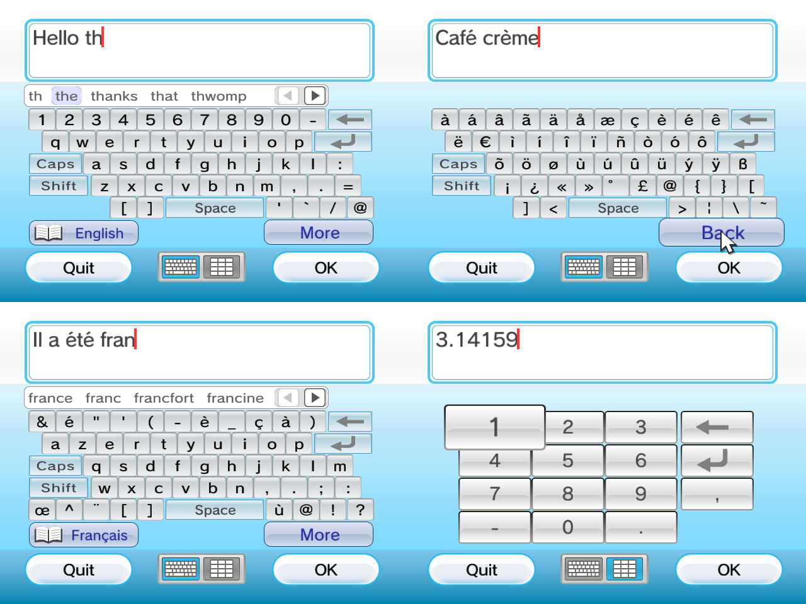
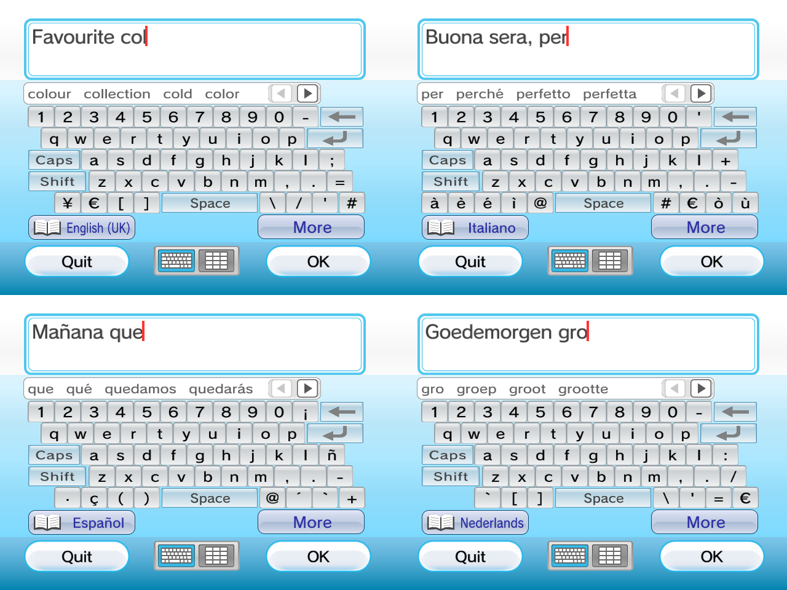

# libwiiosk

On-screen software keyboard library for Wii homebrew, built on libogc / GX.



- The look and feel of the Wii system keyboard: glass keys that grow under the pointer, a two-line
  text box with a pulsing caret, Quit / OK buttons and letters / numpad tabs in the toolbar
- The system keyboard's letter layouts: US, UK, Italian, Spanish and Dutch QWERTY, German QWERTZ,
  French AZERTY, plus a numeric keypad. `OSK_UseSystemLanguage()` picks the layout and dictionary
  from the console language
- A "More" page on every letter layout with accented Latin-1 letters, `€` and extra symbols
- Predictive text in nine languages from the Wii keyboard's eZiText dictionaries, with a
  candidate bar like the system keyboard's; only the languages you reference are linked
- The system keyboard's sound effects (19 sounds, 26 KB), played through ASND or handed to your
  own mixer
- Shift (one-shot), Caps Lock, caret movement, auto-repeat, max length (up to 2048 characters), password mode, optional
  line breaks
- Input from the Wii Remote pointer and buttons, the Classic Controller, the GameCube controller and USB keyboards
- 4:3 and 16:9 (anamorphic) output, NTSC and PAL
- UTF-8 in and out
- No asset files: every texture is generated at startup, and the anti-aliased proportional font
  (Rodin NTLG Pro DB, the Wii system font) is compiled in. All built-in data (font, dictionaries,
  sounds) is stored compressed with a small context-modelling range coder and unpacked on first use
- Two ways to use it:
  - Inside your own GX render loop with `OSK_Update()` and `OSK_Draw()`.
  - As a blocking `OSK_Prompt()` for console/framebuffer apps.

## Building

Needs devkitPPC and libogc.

```sh
make                 # lib/libwiiosk.a
make install         # copies header + lib to $DEVKITPRO/portlibs/wii
make example         # example/gx/wiiosk_gx.dol, example/console/wiiosk_console.dol
make -C tests/selftest
```

Link with `-lwiiosk -lwiiuse -lbte -logc -lm`. Add `-lwiikeyboard` only if you call
`OSK_InitUSBKeyboard()`, and `-lasnd` only if you call `OSK_InitSound()`.

## Usage in a GX app

```c
#include <wiiosk.h>

osk_config cfg;
OSK_DefaultConfig(&cfg);
cfg.title         = "Enter your name";   /* placeholder while the box is empty */
cfg.initial       = "Player";
cfg.max_chars     = 24;
cfg.layout        = OSK_LAYOUT_QWERTY;
cfg.screen_width  = rmode->fbWidth;
cfg.screen_height = rmode->efbHeight;
if (CONF_GetAspectRatio() == CONF_ASPECT_16_9)
    cfg.flags |= OSK_FLAG_WIDESCREEN;

/* pointer support */
WPAD_SetDataFormat(WPAD_CHAN_0, WPAD_FMT_BTNS_ACC_IR);
WPAD_SetVRes(WPAD_CHAN_0, rmode->fbWidth, rmode->efbHeight);

osk_keyboard *osk = OSK_Create(&cfg);

for (;;) {
    osk_input in;
    WPAD_ScanPads();
    PAD_ScanPads();
    OSK_ReadInput(&in, WPAD_CHAN_0, PAD_CHAN0);   /* -1 skips a controller type */

    osk_status st = OSK_Update(osk, &in);
    if (st == OSK_STATUS_DONE) { use(OSK_GetText(osk)); break; }
    if (st == OSK_STATUS_CANCELLED) break;

    draw_my_scene();
    OSK_Draw(osk);          /* covers the whole screen */
    /* GX_DrawDone / GX_CopyDisp / VIDEO_SetNextFramebuffer as usual */
}
OSK_Destroy(osk);
```

`OSK_Draw()` changes GX state: projection, position matrix 0, vertex format 0, TEV stages 0-1,
TEV registers 0-1, texmap 0, channels, blending, alpha compare and Z mode. Set them again before
your own drawing. The textures are built by the first `OSK_Create()` (about 0.4 MB, kept until exit).

## Usage from a console app

```c
char name[64];
osk_config cfg;
OSK_DefaultConfig(&cfg);
cfg.title = "What is your name?";
if (OSK_Prompt(&cfg, rmode, xfb, name, sizeof(name)) == OSK_STATUS_DONE)
    printf("Hello %s\n", name);
```

`OSK_Prompt()` initialises GX on first use. Pass `OSK_FLAG_GX_READY` if your app has already
initialised GX. It takes over the display and restores your framebuffer contents when it returns.
It switches the Wii Remote on channel 0 to IR mode, so set your own data format again afterwards.

## Predictive text

```c
cfg.dictionary = &osk_dict_en_us;
```

This adds a prediction key with a book icon and the language name at the bottom left of the
letter pages. While prediction is on, a bar above the keys suggests words that start with the
letters before the caret. Choosing one replaces the word and adds a space. Suggestions follow the
typed capitalisation (`Th` → `The`, `HEL` → `HELLO`). A base letter also matches its accented
forms (`resume` → `résumé`), but an accented letter only matches itself. Point at a word and press
A, or press Up from the top key row and use the D-pad. The arrows at the right of the bar page
through up to 20 suggestions. Prediction never appears in password mode or on the numpad.

| Dictionary         | Language                | Size   |
|--------------------|-------------------------|--------|
| `osk_dict_en_us`   | English (US)            | 61 KB  |
| `osk_dict_en_gb`   | English (UK)            | 67 KB  |
| `osk_dict_de`      | German                  | 77 KB  |
| `osk_dict_fr`      | French                  | 58 KB  |
| `osk_dict_fr_ca`   | French (Canada)         | 56 KB  |
| `osk_dict_es`      | Spanish                 | 79 KB  |
| `osk_dict_es_la`   | Spanish (Latin America) | 78 KB  |
| `osk_dict_it`      | Italian                 | 75 KB  |
| `osk_dict_nl`      | Dutch                   | 78 KB  |

Sizes are as linked; each dictionary is stored compressed and unpacked the first time a keyboard
uses it, into 80–115 KB of heap that is kept until `OSK_FreeDictionaries()`.

To follow the console's language like the system keyboard does:

```c
OSK_UseSystemLanguage(&cfg);   /* sets cfg.layout and cfg.dictionary */
```

The console language selects both the letter layout and the dictionary (the numpad stays the
numpad). The USA, Brazil and Latin America areas get the American dictionaries (`en_us`, `fr_ca`,
`es_la`) and every other area the European ones. Japanese, Chinese and Korean get US QWERTY
without prediction. This links all nine dictionaries (about 630 KB). To ship only some, switch on `OSK_SystemLanguage()`, which
links no dictionary data:

```c
switch (OSK_SystemLanguage()) {
case OSK_LANG_DE: cfg.dictionary = &osk_dict_de; break;
case OSK_LANG_FR: cfg.dictionary = &osk_dict_fr; break;
default:          cfg.dictionary = &osk_dict_en_us; break;
}
```

`OSK_SystemDictionary()` and `OSK_SystemLayout()` return just one of the two, and
`OSK_LanguageDictionary()` and `OSK_LanguageLayout()` map any `osk_language`.

| Language | Layout                                             | Dictionary         |
|----------|----------------------------------------------------|--------------------|
| English  | `OSK_LAYOUT_QWERTY` (US) or `OSK_LAYOUT_QWERTY_UK`  | `en_us` or `en_gb` |
| German   | `OSK_LAYOUT_QWERTZ`                                | `de`               |
| French   | `OSK_LAYOUT_AZERTY`                                | `fr` or `fr_ca`    |
| Spanish  | `OSK_LAYOUT_QWERTY_ES`                             | `es` or `es_la`    |
| Italian  | `OSK_LAYOUT_QWERTY_IT`                             | `it`               |
| Dutch    | `OSK_LAYOUT_QWERTY_NL`                             | `nl`               |



Each dictionary is a separate object in `libwiiosk.a`, so only the ones you reference are linked.
To use dictionary files instead, for example from SD, load an eZiText `.zsd` (and optionally a
`.znd` of extra words) into memory and wrap them:

```c
osk_dictionary dict;
if (OSK_DictionaryFromMemory(&dict, "English", zsd, zsd_size, znd, znd_size))
    cfg.dictionary = &dict;     /* the buffers must outlive the keyboard */
```

Damaged files cannot crash the keyboard: every read is bounds-checked and every search has a step
budget. `OSK_FLAG_PREDICT_OFF` starts with prediction switched off. `OSK_SetPrediction()`,
`OSK_GetCandidateCount()`, `OSK_CopyCandidate()` and `OSK_ChooseCandidate()` give programmatic
access.

The dictionaries store no word frequencies, but their word graph lists common words first. wiiosk
ranks the typed word itself first, then its accented forms, then the graph's order. Up to two of
the extra words (Wii, Nunchuk, …) are placed after the first three suggestions.
`tools/mkdict.py <eZiTextTools data dir> source/dict` regenerates `source/dict/`.

## Sounds

```c
OSK_InitSound(true);    /* true: also call ASND_Init(); link -lasnd */
```

After this, every keyboard plays the system keyboard's sound effects: focus ticks, typing,
delete, refusals, caret moves, Shift, More, the tabs, prediction, opening, OK and Cancel. Typing,
delete and choosing a word vary their pitch slightly, like the original. `OSK_SetSoundVolume()`
sets the ASND voice volume. The sounds are decoded on first use.

Apps with their own mixer set `cfg.on_sound` instead (it replaces the ASND playback) and fetch
the samples with `OSK_GetSound()`. Those are mono s16 at 10.7, 16 or 32 kHz, with the pitch
variation in cents. The sound data is a separate object, so apps that use neither function do not
link it. `tools/mksound.py` renders the sounds from the keyboard's sound archive
(`wiiSoftwareKeyboardSound.brsar`). It interprets the sequences, samples the bank's DSP-ADPCM
instruments with their envelopes, and stores each sound at the lowest rate that keeps its sound,
as 4-bit IMA ADPCM, then packs the result (26 KB).

## libinput-wii

Apps that read their controllers with [libinput-wii](https://github.com/quatric/libinput-wii) can
feed the keyboard from it instead of `OSK_ReadInput()`:

```c
#include <input_wii.h>
#include <wiiosk_input_wii.h>

INPUT_Init();
INPUT_SetScreenSize(cfg.screen_width, cfg.screen_height);
...
INPUT_Update();
OSK_ReadInputWii(&in);
OSK_Update(osk, &in);
```

`wiiosk_input_wii.h` is header-only, and libwiiosk.a does not contain or link libinput-wii, which is
AGPL-3.0 licensed. The adapter reads the controllers (every pad libinput-wii supports, folded onto
Wii Remote buttons, plus the Nunchuk's Z for More and C for Space). The pointer comes from
libinput-wii's cursor, so the Wii Remote and a USB mouse both work, and the left mouse button
presses keys. Keys come from its keyboard queue, and held Backspace, Delete and arrow keys repeat.
Do not also call `OSK_InitUSBKeyboard()`: libinput-wii already owns the keyboard. libinput-wii maps
GameCube Start to HOME, so on a GameCube pad Start cancels. `example/input_wii` shows the whole
loop; build it with `make -C example/input_wii LIBINPUT_WII=/path/to/libinput-wii` (it also needs
`-lwiikeyboard`).

## Controls

| Action        | Wii Remote | Classic | GameCube      | USB keyboard  |
|---------------|------------|---------|---------------|---------------|
| Press key     | A (point or D-pad) | A | A          | (type)        |
| Move focus    | D-pad      | D-pad   | D-pad / stick |               |
| Erase         | B          | B       | B             | Backspace / Delete |
| Move caret    | 1 / 2      | L / R   | L / R         | ← → Home End  |
| Shift         | −          | −       | Y             | (keyboard's own) |
| More page     |            | Y       | Z             |               |
| Space         |            | X       | X             | Space         |
| OK            | +          | +       | Start         | Enter (line break with `OSK_FLAG_MULTILINE`) |
| Cancel        | HOME       | HOME    | (Quit button) | Esc           |

To move the caret with the pointer, point into the text box and press A. The arrows that appear
at the right of the text box move the caret a line up or down.

## Options

- `filter`: a callback that refuses code points, for example digits only. Keys whose character is
  refused are drawn greyed out.
- `on_event`: a callback for focus changes, key presses, rejects, done and cancel. Use it for rumble;
  `example/gx` uses it for Wii-Menu-style rumble. For sounds, see `on_sound` above.
- `theme`: copy `*OSK_DefaultTheme()` and change the colours you want. Since 2.0 only some fields
  have an effect; `wiiosk.h` lists them.
- Flags:
  - `OSK_FLAG_PASSWORD`: show `*` for every character
  - `OSK_FLAG_WIDESCREEN`
  - `OSK_FLAG_NO_CANCEL`: hide Quit
  - `OSK_FLAG_REQUIRE_TEXT`: OK is refused while the text is empty
  - `OSK_FLAG_NO_POINTER`
  - `OSK_FLAG_GX_READY`
  - `OSK_FLAG_MULTILINE`: Enter inserts `\n` instead of confirming
  - `OSK_FLAG_NO_ENTER`: hide the Enter key
  - `OSK_FLAG_LOCK_LAYOUT`: hide the letters / numpad tabs
  - `OSK_FLAG_PREDICT_OFF`: start with word prediction switched off
  - `OSK_FLAG_NO_HINTS`: no effect since 2.0

The keyboard accepts any character `OSK_CanDisplay()` reports. That covers printable ASCII,
Latin-1, `Œ œ` and `€`. It does not include CJK.

## Compression

The font atlas, the dictionaries and the sounds are packed by `tools/rcpack.py`, an adaptive binary
range coder like LZMA's with a context model per kind of data. The font uses neighbouring pixels,
the sounds the previous ADPCM nibbles, and the dictionaries the structure of the eZiText word graph
(node heads, character indexes and pointer bytes are modelled apart). `source/osk_unpack.c`
decodes them. Unpacking needs up to 380 KB of temporary memory (for a dictionary), freed right
after.

| Data                 | Raw    | LZSS                 | Packed |
|----------------------|--------|----------------------|--------|
| Font atlas           | 62 KB  | 21 KB                | 14 KB  |
| Sounds (IMA ADPCM)   | 47 KB  | 35 KB                | 26 KB  |
| Dictionaries (all 9) | 889 KB | larger than raw      | 628 KB |

## Upgrading from 1.x

- The keyboard now fills the screen and uses the Wii system keyboard layout. Pointer coordinates
  of keys changed, and the default focus is `q`.
- `title` is a placeholder inside the empty text box instead of a heading.
- The Alt key is the "More" button; the Cancel key is the Quit button in the toolbar. The ← / →
  caret keys are gone; use the 1 / 2 buttons or the pointer.
- The help line and the character counter are gone, so `OSK_FLAG_NO_HINTS` does nothing.
- On the German and French layouts, Caps and Shift follow the tables of the Wii keyboard (French
  Caps gives digits on the top row).

## Tests

`tests/selftest` drives `OSK_Update()` with scripted input and needs no controller. It covers
editing, max length, UTF-8, navigation and wrap, Shift and Caps, the More page, auto-repeat, 4:3 and
16:9 pointer mapping, the caret pointer, Enter and line breaks, the toolbar buttons and tabs, the
German and French tables, filters and flags, the sound triggers and decoder, and word prediction (ranking, capitalisation, accents,
the bar, scrolling, the length limit, damaged dictionaries and the console language mapping). On the Wii the verdict appears in the text box
(`SELFTEST PASS n/n`), then it cycles through every layout for a visual check. It runs in Dolphin.

The same cases also build for the desktop, together with a preview tool that draws the keyboard
with a software rasterizer that follows the GX path:

```sh
make -C tools/preview
tools/preview/wiiosk_selftest
tools/preview/wiiosk_preview out_dir 2     # one PNG per scene, at 2x
```

## Layout of this folder

```
include/wiiosk.h            public API
include/wiiosk_input_wii.h  libinput-wii adapter (header only)
source/                     library sources
source/dict/                generated dictionaries, one object per language
example/gx                  GX integration example
example/console             OSK_Prompt() example
example/input_wii           input through libinput-wii
tests/selftest              scripted self-test
tools/mkfont.py             generates source/osk_font_data.c from the font
tools/mkdict.py             generates source/dict/ from eZiText dictionaries
tools/mksound.py            generates source/osk_sound_data.c from the keyboard's sound archive
tools/rcpack.py             the compressor for all built-in data (source/osk_unpack.c decodes)
tools/preview               desktop build: previews and self-test
nintendo_sdk_original/      original SDK package (local reference only, git-ignored)
```

## Provenance

This folder used to hold Nintendo's 2009 *Software Keyboard* SDK sample, which is NintendoWare/RVL
SDK code. That material is kept in `nintendo_sdk_original/` only for local reference and must not be
redistributed. wiiosk is a separate, original implementation that uses only libogc. The look is
modelled on the Wii system keyboard and recreated with procedurally generated graphics; no Nintendo
code, layouts or textures are included.

The dictionaries in `source/dict/` are not original work. They are the eZiText word lists by Zi
Corporation that ship with the Wii keyboard (`eZTSystem*.zsd`, `eZTNintendo*.znd`), as published
in [eZiTextTools](https://github.com/quatric/eZiTextTools). `tools/mkdict.py` keeps only the word
graph and the blocklist. They are not covered by the zlib license. If that matters for your project,
leave `cfg.dictionary` unset (then nothing of them is linked) or load your own dictionary.

The sound effects in `source/osk_sound_data.c` are not original work either. They are rendered
from Nintendo's `wiiSoftwareKeyboardSound.brsar` (the archive itself is not included) and are not
covered by the zlib license. They are linked only if you call `OSK_InitSound()` or `OSK_GetSound()`.

The font is FOT-Rodin NTLG Pro DB by Fontworks, the typeface used by the Wii system menu. It is a
commercial font and is not included; `source/osk_font_data.c` holds glyph bitmaps rendered from it by
`tools/mkfont.py`. To build with a different font, pass its TTF/OTF to `tools/mkfont.py`.
